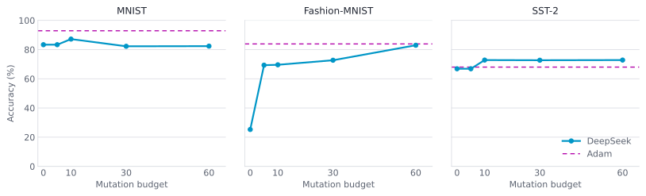
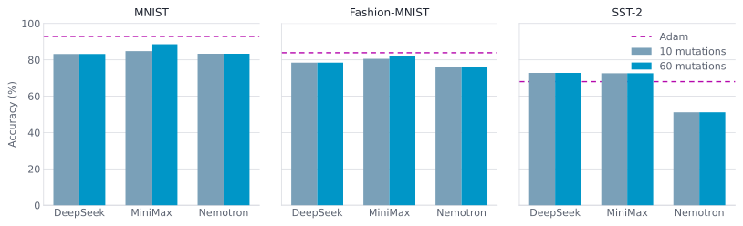
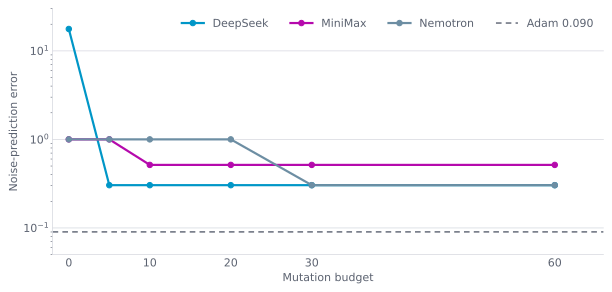
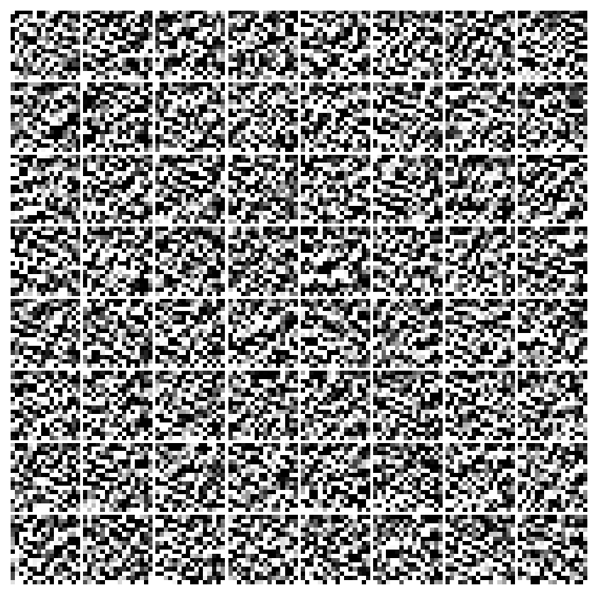
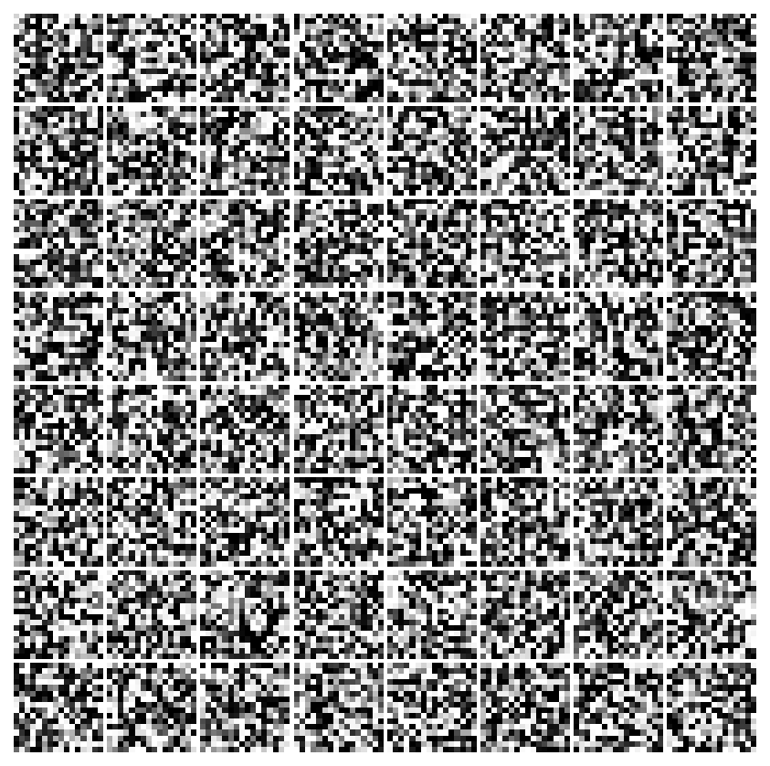
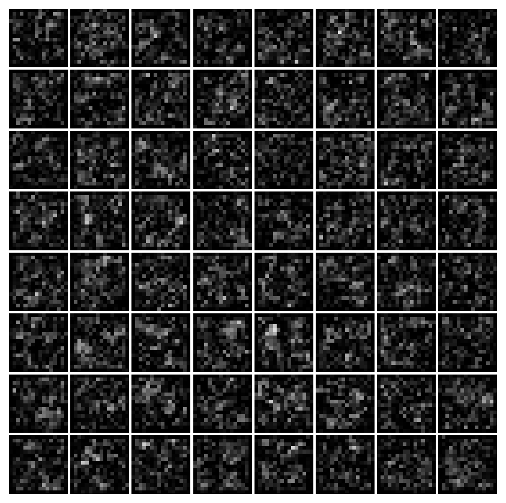
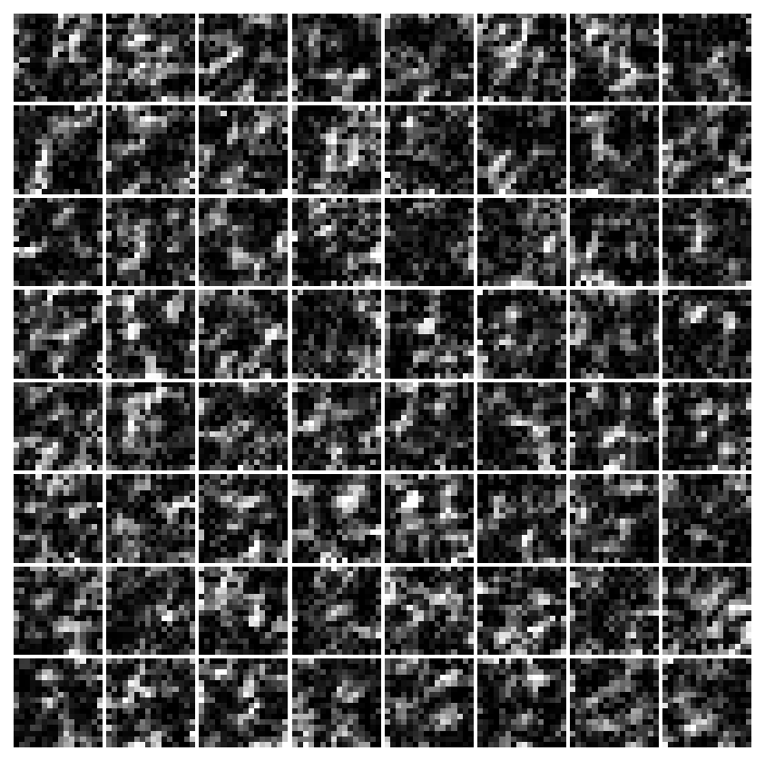
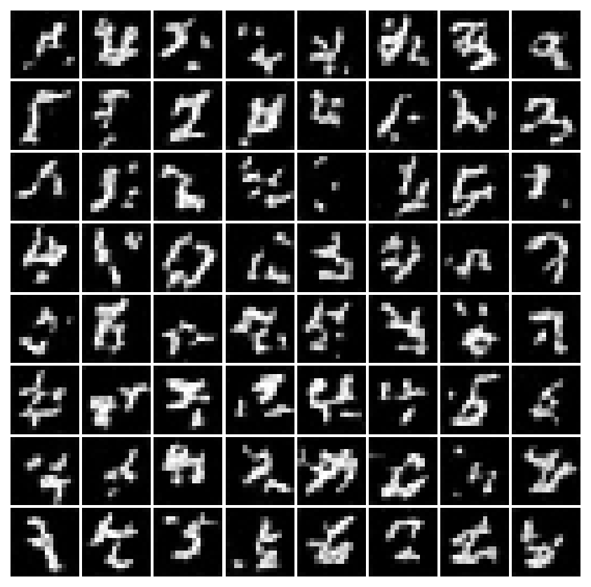

---
date:
  created: 2026-11-06
authors:
  - devichand
guest: true
slug: weight-space-programming
readtime: 15
title: "Weight-space programming through programs with GEPA"
description: "GEPA searches over programs that write network weights, rather than writing the weights directly."
social_image: blog/2026-11-06-weight-space-programming/images/fig1.png
citation_authors:
  - "Devichand Budagam"
citation_keywords: "GEPA, weight-space programming, Pareto search, neural network weights, program synthesis, MNIST, Fashion-MNIST, SST-2, diffusion"
external_links_new_tab: true
---

# Weight-space programming through programs with GEPA

[Weight-Space Programming](https://rikiyat.github.io/blog/weight-space-programming/) had shown that a language model can read and write weights directly. We apply [GEPA](https://arxiv.org/abs/2507.19457) around those weights but through symbolic programs that writes the layers and weights of a network. The motivation is to undertand that whether pareto based search could perform better than one-shot weight-space programming or an Adam optimiser to optimise a neural network. The code is available [here](https://github.com/devichand579/gepa_wsp).

<!-- more -->

A candidate is a program, `edit(w, f)`. It can read the training arrays, the current weights, forward activations, and simple statistics, and it can fit a closed-form model but could not apply a parameter gradient or a Newton update. Validation inputs, labels, and traces stay out of the program and out of the reflection. A candidate is accepted when every parameter keeps its key, shape, and float32 type, every value is finite, and no magnitude exceeds a pre-defined threshold. A program that fails those checks leaves the current weights unchanged. GEPA then scores the frozen network on the validation slice and chooses the next parent from the Pareto set. Classification tasks keeps the candidate with the higher accuracy and diffusion keeps the candidate with the lower noise-prediction error.

Three reasoning models were used. DeepSeek-Flash (DeepSeek), MiniMax-Flash (MiniMax) and Nemotron-lightning (Nemotron) were used. The table below describes the four tasks, datasets and networks optimised.

| Task | Network | Parameters | Training | Validation | Test |
| --- | --- | --- | --- | --- | --- |
| MNIST | MLP | 101,770 | 2,000 | 1,000 | 10,000 |
| Fashion-MNIST | CNN | 20,490 | 2,000 | 1,000 | 10,000 |
| SST-2 | Transformer | 83,266 | 4,000 | 1,000 | 872 |
| Diffusion | Denoiser | 56,609 | 2,000 | 1,000 | 10,000 |

## Results

[Figure 1](#figure-1) shows the results on three tasks with DeepSeek as the LLM used for reflection. The Fashion-MNIST is the large move. The one-shot program failed, so the network stayed at 25.28%. After 60 mutations it reached 82.97%, just under Adam at 83.87%. MNIST started at 83.34%, reached 87.18% at 10 mutations, and ended at 82.35%, still below Adam at 92.87%. SST-2 rose from 66.86% to 72.82% by 10 mutations and stayed there, above Adam at 68.00%.

<figure markdown="span">
  { style="width: 100%;" }
  <figcaption id="figure-1">Figure 1. DeepSeek reflection.</figcaption>
</figure>

## How Does Compact Reflection Affect the Performance ?

What happens if reflection context is compressed: the shown examples, the class summaries, the layer summaries, the weights, and the last four proposals. What changes is how much of that is sent to the LLM.

Displayed numbers stay rounded to four decimals. A weight matrix larger than 4,096 values is cut to a slice of rows. If the message is still over 180,000 bytes, the numeric report from an older proposal is left out. If it is still too long, the displayed weight values are removed. The program keeps every weight at full precision and the full training arrays. Only the text the model reads is shorter.

[Figure 2](#figure-2) shows the results of all three models on all three tasks across two mutation budgets. MiniMax gained 3.82 points on MNIST and 1.28 on Fashion-MNIST. DeepSeek and Nemotron stayed flat on every task. MiniMax's one-shot programs failed and left the random weights in place, so part of its gain is the repair of that failure. On SST-2, DeepSeek and MiniMax again finish above Adam, while Nemotron stays at 51.15%.

<figure markdown="span">
  { style="width: 100%;" }
  <figcaption id="figure-2">Figure 2. Compact reflection, three models.</figcaption>
</figure>

## How good was Denoising ?

Denoising used the shorter reflection as in the pevious experiment. The network is an unconditional denoiser on MNIST resized to 16 × 16, and it predicts the noise added at one of 32 cosine steps. Each candidate saw one frozen noise draw for the 2,000 training images. That draw was shared by DeepSeek, MiniMax, and Nemotron and stayed fixed across mutations. Adam trained on a new minibatch of 64 images, a new timestep, and fresh noise at every step. A candidate runs once and cannot run that loop, so the noise stays fixed. Every candidate reads those same noisy images, and running that candidate again writes the same weights.

Held-out error fell from 17.68 to 0.304 for DeepSeek, from 1.001 to 0.515 for MiniMax, and from 1.001 to 0.304 for Nemotron. Adam reached 0.090. From 20 mutations to 60, DeepSeek and MiniMax did not move, and Nemotron caught up with DeepSeek. Lower denoising error still left the samples looking mostly like noise.

<figure markdown="span">
  { style="width: 100%;" }
  <figcaption>Figure 3. Denoising error.</figcaption>
</figure>

### DeepSeek

<figure markdown="span">
  { style="width: 100%;" }
  <figcaption>One shot. MSE 17.679</figcaption>
</figure>

<figure markdown="span">
  { style="width: 100%;" }
  <figcaption>60 mutations. MSE 0.304</figcaption>
</figure>

### MiniMax

<figure markdown="span">
  { style="width: 100%;" }
  <figcaption>One shot. MSE 1.001</figcaption>
</figure>

<figure markdown="span">
  { style="width: 100%;" }
  <figcaption>60 mutations. MSE 0.515</figcaption>
</figure>

### Nemotron

<figure markdown="span">
  { style="width: 100%;" }
  <figcaption>One shot. MSE 1.001</figcaption>
</figure>

<figure markdown="span">
  { style="width: 100%;" }
  <figcaption>60 mutations. MSE 0.304</figcaption>
</figure>

### Adam

<figure markdown="span">
  { style="width: 70%;" }
  <figcaption>Trained baseline. MSE 0.090</figcaption>
</figure>

## Open Directions

Reflection here keeps a program when its validation score improves. [Figure 1](#figure-1) shows the two outcomes of that rule: Fashion-MNIST is repaired from 25.28% to 82.97%, SST-2 finishes above Adam because the program stores a bag-of-words classifier, and MNIST peaks at 87.18% then ends at 82.35%. The direction is to give GEPA the same rule on direct weight writes, and see whether the model makes the same repair and the same fit when it writes the numbers itself.

Each program rewrites every layer, and the Pareto set keeps or drops the whole network. The MNIST drop in [Figure 1](#figure-1) is the cost of taking every layer. The Fashion-MNIST move in that figure, from 72.70% at 30 mutations to 82.97% at 60, is the same whole-network replacement. The direction is a Pareto set that can keep one layer and leave the others in place.

That layer-wise search has two forms. One stays with programs. The other uses GEPA on direct weight-space programming, so the model edits the weights of one layer and the Pareto set keeps or drops that layer. In [Figure 2](#figure-2) performance is mostly unchanged after 10 mutations, and Adam stays ahead on the image classification tasks. Running both forms asks whether a smaller edit closes that gap, and whether the direct write and the program still share a bias once a single layer can be included.

[Can LLMs redesign themselves as they train?](https://www.doubleai.com/research/can-llms-redesign-themselves-as-they-train) is an intial attempt for layer-wise programming during training of a network. They adds a new code layer during ordinary training, and every existing layer keeps training. We instead propose to take the phantom gradient proposed in their experiments as the core and then train by pareto search alone through GEPA. The phantom gradient names the layer whose demand is unmet. The search then changes the weights of that one existing layer, the network keeps its shape, and the other layers stay fixed. The edit is included in the pareto set if the valifdation score improves.

## References

[Sparks of Weight-Space Programming](https://rikiyat.github.io/blog/weight-space-programming/)  
Rikiya Takehi, Jayden Teoh, Alex Zhang & Omar Khattab, 2026.

[GEPA: Reflective Prompt Evolution Can Outperform Reinforcement Learning](https://arxiv.org/abs/2507.19457)  
Lakshya A. Agrawal et al., ICLR 2026.

[Can LLMs redesign themselves as they train?](https://www.doubleai.com/research/can-llms-redesign-themselves-as-they-train)  
doubleAI, 2026.
