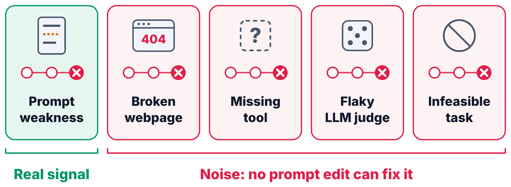
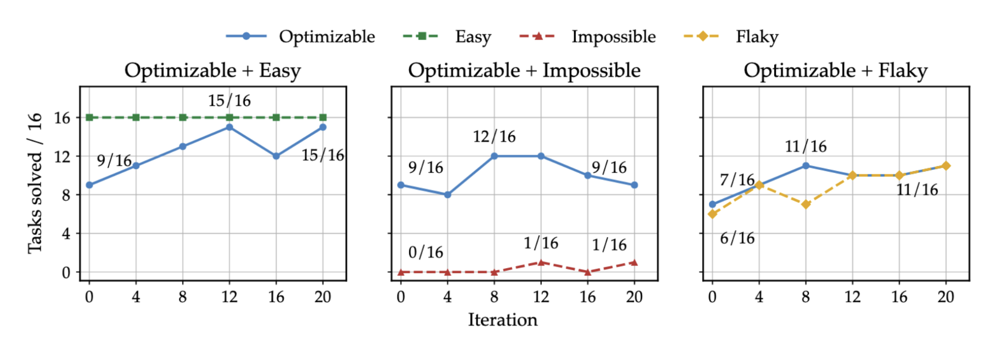
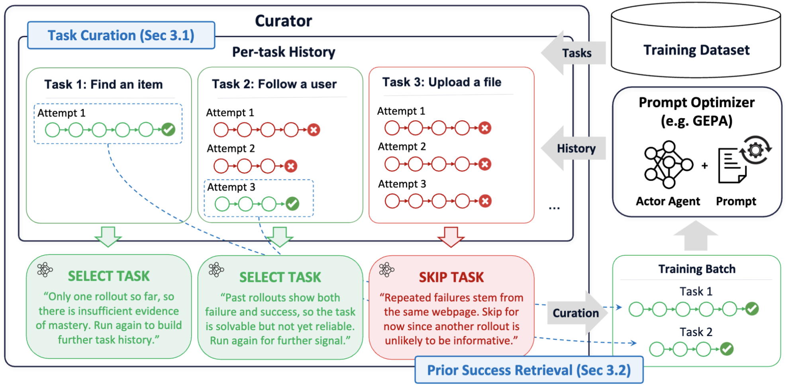
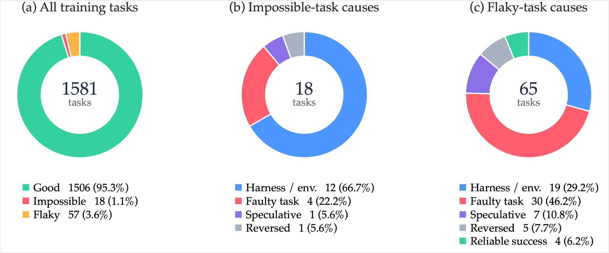

---
date:
  created: 2026-11-04
slug: gepa-curator
title: "GEPA-Curator: Curated Learning For Self Improving Agents"
description: GEPA-Curator is an agentic Curator that sits on top of reflective prompt optimizers and decides which agent experiences should shape the prompt, filtering out noisy tasks and retrieving trusted past successes for the Reflector.
citation_authors:
  - "Zack Yu"
  - "Nicholas Lee"
  - "Minjae Lee"
  - "Lakshya A Agrawal"
  - "Luca Manolache"
  - "Wonjun Kang"
  - "Matei Zaharia"
  - "Michael W. Mahoney"
  - "Kurt Keutzer"
  - "Sehoon Kim"
  - "Amir Gholami"
---

# GEPA-Curator: Curated Learning For Self Improving Agents

[Zack Yu](https://zack041.github.io/)\*, [Nicholas Lee](https://nicholaslee.me/)\*, [Minjae Lee](https://www.linkedin.com/in/mjleeofficial/), [Lakshya A Agrawal](https://x.com/LakshyAAAgrawal), [Luca Manolache](https://www.linkedin.com/in/luca-manolache-53569b220), [Wonjun Kang](https://www.linkedin.com/in/wonjun-kang-43b181342/), [Matei Zaharia](https://people.eecs.berkeley.edu/~matei/), [Michael W. Mahoney](https://www.stat.berkeley.edu/~mmahoney/), [Kurt Keutzer](https://people.eecs.berkeley.edu/~keutzer/), [Sehoon Kim](https://sehoonkim.org/)\*\*, [Amir Gholami](https://amirgholami.org/#about)\*\*

\* Equal Contribution \*\* Equal Advising

**TL;DR.** Reflective prompt optimizers like GEPA improve agents by reading failed rollouts and revising the prompt. But in agentic settings, a failure is not always the prompt's fault: the harness may be missing a tool, the website may be broken, the task may be underspecified, or the LLM judge may simply be flaky. When the Reflector treats these failures as lessons, it writes rules that fix nothing and can break tasks that used to work.

We introduce **GEPA-Curator**, an agentic Curator that runs as a harness on top of an existing prompt optimizer and decides *which experiences should shape the prompt*. It does two things:

- **task curation**: skip tasks whose rollouts are unlikely to carry useful signal

- **prior success retrieval**: hand the Reflector a trusted past success of the same task.

When GEPA-Curator is applied upon GEPA, it is capable of the following:

- Improving upon [GEPA on multiple WebArena websites, with both Gemini 3.1 Pro and Claude Opus 5 as optimizer](#webarena), achieving up to **1.78×** GEPA's optimization gain over the seed prompt.

- Improving upon [GEPA and ACE on ALFWorld, AppWorld, and τ-bench](#agentic-benchmarks), with gains of up to **20.7 points over GEPA** and **21.2 points over ACE**.

- [Costs only 1.31× GEPA, and is 4.42× cheaper than ACE](#cost) while reaching higher accuracy.

- [Carries over to harness-code optimization](#meta-harness): adding the Curator to Meta-Harness improves held-out performance.

<!-- more -->

<figure>
  <video controls playsinline preload="metadata" aria-label="GEPA-Curator overview" style="width: 100%; height: auto;">
    <source src="../../../../2026-11-4-gepa-curator/images/gepa-curator.mp4" type="video/mp4">
    Your browser does not support embedded video. <a href="../../../../2026-11-4-gepa-curator/images/gepa-curator.mp4">Download the GEPA-Curator video</a>.
  </video>
</figure>

## When Failure Isn't the Prompt's Fault

Reflective prompt optimization is one of the most practical forms of self-improvement we have today: an agent acts in an environment, a Reflector reads the resulting trajectory, and the prompt gets revised for the next round. The whole loop rests on one assumption, that the **experience from past tasks contains signals that generalizes to future tasks.**

A zero score tells the Reflector that the rollout failed. It still has to decide what, if anything, a change to the prompt would fix.

<figure markdown="span">
  { style="width: 100%;" }
  <figcaption>These five rollouts can all end with the same score. A prompt edit can address an agent mistake. A broken webpage or an unreliable judge calls for a different diagnosis.</figcaption>
</figure>

Consider an agent buying an item on a shopping site. If it fails because it skipped a required option before adding to cart, the Reflector can usefully add "check required fields before proceeding." However, if it fails because the purchase button was temporarily broken, the Reflector may learn "the button does not work, so look for alternative ways to complete the purchase." That is noise at best, and actively harmful once the button works again, since the agent keeps avoiding it.

### Isn't validation gating enough?

GEPA already guards against bad mutations, it re-evaluates a mutated prompt on the minibatch and only accepts it if the score doesn't drop, and other optimizers use held-out validation sets for the same purpose. But gating has two blind spots:

1. **Aggregate scores are noisy.** Stochastic execution and flaky judges mean bad mutations can slip through and good ones can be rejected.

1. **Gating only sees the output.** It can reject a bad edit, but the Reflector has already reflected on noisy failures, so that round of rollouts is wasted. Further, the next reflection faces the same noise without getting any better.

That second point is the key motivation for GEPA-Curator. Rather than only filtering what comes *out* of the Reflector, we curate what goes *in*.

### Noisy tasks contaminate the prompt

To see how much this matters, we split GoBrowse GitLab tasks into four groups: **Easy** (already solved by the seed prompt), **Optimizable** (initially weak but improvable by prompting), **Impossible** (always fail), and **Flaky** (mixed outcomes due to ambiguous intent or judge noise). We then run GEPA on Optimizable tasks mixed with each of the other three.

<figure markdown="span">
  { style="width: 100%;" }
  <figcaption>GitLab validation over 20 iterations. The blue line in each panel tracks the Optimizable tasks. The dashed line tracks the group mixed into training.</figcaption>
</figure>

With Easy tasks in the mix, GEPA solves 15 of the 16 Optimizable tasks after 20 iterations. With Impossible and Flaky tasks, it only peaks at 12 and 11, respectively.  The lesson is that **what goes into the training batch matters**: the same optimizer learns much less, even on the tasks we know a prompt edit can fix, when the mix includes tasks that can't teach it anything.

## GEPA-Curator

GEPA-Curator treats the prompt optimizer as a black box: it takes a prompt and a minibatch of tasks, and returns an updated prompt. The Curator sits outside this loop. It logs every rollout into a **per-task history** (i.e. trajectories and outcomes), then uses that history (1) to choose which tasks to learn from, and (2) to retrieve a prior success to show the Reflector. Both are passed to the optimizer as extra input metadata; the optimizer itself is unchanged.

<figure markdown="span">
  { style="width: 100%;" }
  <figcaption>An example of the Curator choosing tasks from per-task history. It selects Task 1, since a single success is weak evidence of mastery. It also selects Task 2 as its mix of successes and failures shows it&#x27;s solvable but not yet reliable. It defers Task 3 after repeated failures on the same webpage.</figcaption>
</figure>

### Task Curation: choosing what to learn from

Instead of shuffling through the dataset, the Curator decides for each task whether another rollout is worth running right now. Unseen and underexplored tasks are run first to build up history. As evidence accumulates, the Curator may skip a task when the history strongly suggests another rollout won't help, for instance:

- **Mastered:** multiple stable, clean successes across separate rollouts, with no recent regression.

- **Operationally impossible:** repeated, independent attempts point to the same missing capability in the tools or UI.

- **Flaky or uninformative:** near-identical behavior keeps getting different outcomes, regardless of prompt changes.

- **Infrastructure failure:** An infrastructural failure caused by error in evaluator, environment, network service etc.

The default under uncertainty is to **run**, not skip: a rollout has information value for testing suspected flakiness or a possible regression. Skipped tasks also get reconsidered, therefore previously mastered tasks can be checked for regression, previously difficult tasks can be re-evaluated, and flaky tasks can also be reconsidered to avoid mistakes. Older task histories are compressed into a compact summary to improve cost efficiency.

### Prior Success Retrieval: compare, don't guess

A standard Reflector sees only the failed trajectory and its evaluation, and has to diagnose the failure from that alone. GEPA-Curator gives it something better: a **trusted past success on the same task**. The Curator selects the most reliable successful trajectory from the task history, favoring consistent evaluation evidence and avoiding ambiguous successes. This successful trajectory is provided to the reflector along with the rollout trajectory upon failure. With a failed and a successful trajectory side by side, the Reflector can perform a kind of contrastive diagnosis, asking what did the agent do differently when it worked?

### Try it on an existing GEPA run

The integration exposes the Curator as a batch sampler. Pass it to `gepa.optimize` alongside your existing adapter, datasets, and evaluation budget. Here, `reflection_lm` is a callable that takes a prompt and returns text. The selector follows the latest accepted prompt, as in the paper’s greedy search.

```python
import gepa

from gepa.strategies.task_curator import TaskCuratorSampler


class LatestAccepted:
    def select_candidate_idx(self, state):
        return len(state.program_candidates) - 1


result = gepa.optimize(
    seed_candidate=seed_candidate, trainset=trainset, valset=valset,
    adapter=adapter, reflection_lm=reflection_lm, max_metric_calls=max_metric_calls,
    batch_sampler=TaskCuratorSampler(lm=reflection_lm, minibatch_size=16),
    candidate_selection_strategy=LatestAccepted(),
)
```

Set the minibatch size on the sampler itself. By default, the Curator keeps the three most recent execution units in detail and can give the Reflector a retained success when the same task later fails.

## Results

We use gpt-oss-120b as the actor and evaluate two optimizer models, Gemini 3.1 Pro and Claude Opus 5, which drive all optimizer-side agents (Reflector and Curator) in a run. GEPA-Curator builds on a simplified, greedy variant of GEPA that keeps a single lineage instead of a Pareto pool. All numbers are held-out test success rates averaged over 5 runs.

### WebArena (GoBrowse) {#webarena}

We evaluate on four GoBrowse websites in WebArena (GitLab, Shopping, Shopping Admin, and Reddit), each split 3:1:1 into train, validation, and test, with 5,000 rollouts per website/method.

| Optimizer model | Method | GitLab | Shopping | Shopping Admin | Reddit | Overall |
|---|---|---:|---:|---:|---:|---:|
| Gemini 3.1 Pro | Seed | 78.2 | 73.5 | 65.2 | 72.6 | 72.4 |
| Gemini 3.1 Pro | GEPA | 82.1 | 83.8 | 71.5 | 77.6 | 78.7 |
| Gemini 3.1 Pro | **GEPA-Curator** | **84.6** | **85.8** | **73.1** | **85.0** | **82.1** |
| Claude Opus 5 | Seed | 79.6 | 73.9 | 67.7 | 71.3 | 73.1 |
| Claude Opus 5 | GEPA | 82.5 | 80.5 | 72.9 | 81.9 | 79.5 |
| Claude Opus 5 | **GEPA-Curator** | **83.1** | **86.5** | **80.3** | **88.2** | **84.5** |

*GoBrowse held-out success rates (%). The largest site-level gain over GEPA is on Reddit with Gemini (77.6 to 85.0) and on Shopping Admin with Claude (72.9 to 80.3).*

GEPA-Curator improves over GEPA on all four websites with both optimizers. Measured as gain over the seed prompt, GEPA-Curator achieves **1.54×** GEPA's improvement with Gemini 3.1 Pro (+9.7 vs. +6.3) and **1.78×** with Claude Opus 5 (+11.4 vs. +6.4).

**Key result:** Curation consistently increases how much a prompt optimizer can extract from the same seed prompt and the same rollout budget, across websites and optimizer models.

### ALFWorld, AppWorld, and τ-bench {#agentic-benchmarks}

To check that curation isn't only useful on noisy web tasks, we also evaluate on ALFWorld, AppWorld (Test-Normal and Test-Challenge), and τ-bench (retail, with user interaction flattened into single requests), and add ACE as a second baseline.

| Optimizer model | Method | ALFWorld | AppWorld Test-N | AppWorld Test-C | τ-bench | Average |
|---|---|---:|---:|---:|---:|---:|
| – | Seed | 66.9 | 8.9 | 5.6 | 52.0 | 33.4 |
| Gemini 3.1 Pro | GEPA | 82.4 | 38.0 | 27.8 | 75.4 | 55.9 |
| Gemini 3.1 Pro | ACE | 90.1 | 55.7 | 34.5 | 80.6 | 65.2 |
| Gemini 3.1 Pro | **GEPA-Curator** | **91.8** | **58.7** | **46.2** | **84.0** | **70.2** |
| Claude Opus 5 | GEPA | 95.8 | 52.9 | 32.5 | **82.9** | 66.0 |
| Claude Opus 5 | ACE | 89.7 | 61.2 | 33.4 | 61.7 | 61.5 |
| Claude Opus 5 | **GEPA-Curator** | **98.4** | **68.8** | **46.4** | **82.9** | **74.1** |

*Held-out success rates (%). The average gives equal weight to the four test settings, counting AppWorld Test-N and Test-C separately.*

With Gemini 3.1 Pro, GEPA-Curator beats both baselines on all four test sets, averaging +14.3 points over GEPA and +5.0 over ACE. With Claude Opus 5, it gains +15.9 on AppWorld Test-N and +13.9 on Test-C over GEPA, and ties GEPA on τ-bench, averaging +8.1 over GEPA and +12.6 over ACE.

**Key result:** Task curation and prior success retrieval are general tools, not a patch for one noisy benchmark. Gains reach 20.7 points over GEPA and 21.2 points over ACE.

## Why Does Curation Work?

### Both components matter, and they're complementary

We ablate each component on the GitLab subset (520 train / 200 eval tasks), keeping the seed prompt, models, and budget fixed.

| Method | Success (%) |
|---|---|
| Seed | 78.2 |
| GEPA | 82.8 |
| Task curation only | 84.2 |
| Prior success retrieval only | 84.7 |
| **GEPA-Curator (full)** | **88.6** |

Each component alone beats GEPA by under 2 points; together they add nearly 6. This fits the intuition: **task curation decides which failures the Reflector sees, and success retrieval improves how it reasons about them.**

### Success/failure counts alone aren't enough

Could a simple rule-based curriculum do the same job? We compare against a numerical curriculum that tracks each task's failure streak and drops tasks that fail too often,  using a subset of GitLab with 168 tasks.

| Method | Success (%) |
|---|---|
| GEPA | 66.2 |
| Numerical curriculum | 62.5 |
| Task curation only | 67.4 |
| **GEPA-Curator** | **70.2** |

The numerical curriculum actually *underperforms* GEPA.  A win/loss record alone can’t tell flaky tasks (no prompt can fix them) from fixable ones: both show a mix of successes and failures. Telling them apart requires reading the trajectories, which is exactly what an agentic Curator can do.

### What does the Curator actually skip?

Across the four GoBrowse runs, the Curator flagged 75 of 1,581 training tasks (4.7%) as impossible or flaky at least once.

<figure markdown="span">
  { style="width: 100%;" }
</figure>

**Most "impossible" diagnoses trace back to the harness or environment** (12 of 18), such as a required tool being unavailable. For flaky diagnoses, **faulty or underspecified task descriptions are the leading cause** (30 of 65), followed by harness/environment limitations, which can lead a lenient judge to accept an actor's claim that a task can't be done.

The Curator also adjusts *how often* it revisits tasks rather than retiring them. Impossible tasks are deferred the longest, with mean skip streaks growing from 5.5 to 8.75 epochs over training. Mastered tasks are deferred longer over time but periodically rechecked for regressions. Flaky tasks are revisited more often to resolve uncertainty.

## What Does It Cost? {#cost}

GEPA-Curator improves upon GEPA with a small increase in optimization cost, and significantly lesser cost than ACE. Since our experiments use a relatively inexpensive actor model, we expect the relative overhead of curation to decrease further when optimizing larger models.

Its cost, including rollouts, reflection, and curation, compares as follows:

| Benchmarks | Method | Total cost (USD) | Avg. accuracy (%) |
|---|---|---|---|
| WebArena (4 sites) | GEPA | 594.05 | 78.7 |
|  | **GEPA-Curator** | 776.88 | **82.3** |
| ALFWorld + AppWorld + τ-bench | GEPA | 132.65 | 55.9 |
|  | ACE | 768.69 | 65.2 |
|  | **GEPA-Curator** | 173.98 | **74.4** |

**Key result:** For a **1.31×** increase in optimization cost, GEPA-Curator gains +3.6 points over GEPA on WebArena and +18.5 points on the other agentic benchmarks. It is **4.42× cheaper than ACE** while scoring 9.2 points higher. Our actor (gpt-oss-120b) is cheap, so curation overhead is a relatively large share of the bill here; with a more expensive actor, the cost ratio to GEPA would shrink considerably.

## Beyond Prompts: Curating Harness Optimization {#meta-harness}

Curation isn't tied to prompts. [Meta-Harness](https://openreview.net/forum?id=tmbOUyFx3R) optimizes an agent's harness *code* with a coding agent, much as GEPA optimizes prompts. We add a Curator that selects a parent harness and a focused subset of training tasks with a rationale, and supplies historical successes when fresh parent runs fail. We call this **Meta-Harness-Curator**.

| Setting | Metric | Meta-Harness | MH-Curator |
|---|---|---|---|
| Math-RAG | Overall accuracy | 45.33 | **46.33** |
| Math-RAG | Overall reward | 45.69 | **47.26** |
| Text classification | Overall accuracy | 48.06 | **51.04** |

**Test scores (%), averaged over three samples per task.**

[Paper on arXiv](https://arxiv.org/abs/2610.37651v1) · [GEPA-Curator implementation](https://github.com/gepa-ai/gepa/pull/560)
